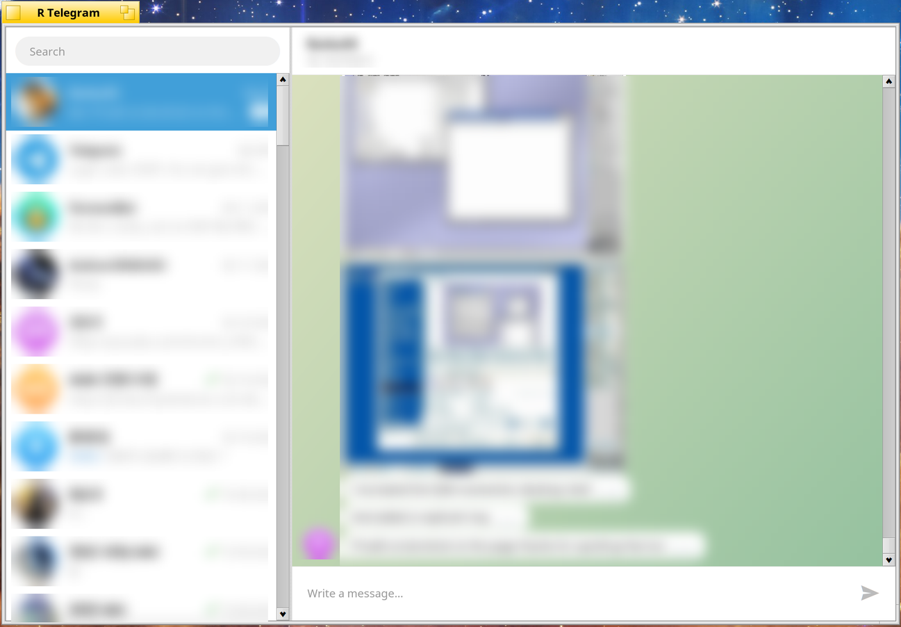

# R Telegram

[English](README.md) | [한국어](README.ko.md)

Haiku와 RenkuOS용 네이티브 Telegram 클라이언트입니다. 프로토콜은 Telegram의
공식 클라이언트 라이브러리 [TDLib](https://github.com/tdlib/td)이 맡고, 모든
창은 Haiku API로 그립니다. Qt는 쓰지 않습니다.

*대화 상대 이름, 대화 내용, 프로필 사진은 흐리게 처리했습니다.*

## 설치

R Telegram은 **arm64**와 **32비트 x86 (x86_gcc2)**용으로 배포됩니다. x86_64용은
아직 없습니다.

1. 아키텍처를 확인합니다. 설치된 `haiku` 패키지 파일 이름 끝이 답입니다.

       ls /system/packages/haiku-*.hpkg
       # .../haiku-r1~beta5_hrev58000-1-arm64.hpkg  ->  arm64

2. 해당 저장소를 추가하고 설치합니다.

   | 아키텍처 | 명령 |
   | --- | --- |
   | arm64 | `pkgman add-repo https://pkgman.rainygirl.com/arm64` `pkgman refresh` `pkgman install rtelegram` |
   | 32비트 x86 (x86_gcc2) | `pkgman add-repo https://pkgman.rainygirl.com/x86_gcc2` `pkgman refresh` `pkgman install rtelegram_x86` |

   `pkgman add-repo`가 `Operation not supported`로 실패하면 그 이미지의
   네트워크 킷에 TLS가 없는 것입니다. 주소의 `https://`를 `http://`로 바꿔
   쓰세요.

3. Deskbar -> 응용 프로그램에서 **R Telegram**을 실행합니다.

4. 처음 실행하면 API 키(아래 절)를 묻고, 이어서 전화번호, 로그인 코드, 설정해
   두었다면 2단계 인증 비밀번호를 묻습니다.

나중에 업데이트하려면 `pkgman update rtelegram`(32비트 x86은 `rtelegram_x86`)을
실행합니다. 지우려면 `pkgman uninstall rtelegram`을 실행합니다. 로그인 세션과
API 키는 `~/config/settings/RTelegram`에 남으니, 이 컴퓨터에서 완전히
로그아웃하려면 이 폴더도 지우세요.

## API 키 받기

Telegram 클라이언트는 모두 `api_id`와 `api_hash`가 필요합니다. R Telegram에는
키가 들어 있지 않으므로, Telegram 계정이 있으면 누구나 받을 수 있는 본인의 키를
씁니다.

1. <https://my.telegram.org>에 들어가 전화번호로 로그인합니다. 확인 코드는
   Telegram 앱으로 옵니다.
2. **API development tools**를 누릅니다.
3. 양식을 채웁니다. App title과 Short name은 아무거나 괜찮습니다(예:
   "R Telegram", "rtelegram"). Platform은 "Desktop"을 고르면 됩니다. 앱을
   만듭니다.
4. **App api_id**(숫자)와 **App api_hash**(32자)를 복사합니다.

R Telegram을 실행하면 나오는 창에 붙여 넣습니다. 키는
`~/config/settings/RTelegram/api`에 본인만 읽을 수 있게 저장되고, Telegram에
로그인하는 데에만 쓰입니다. 다른 키를 넣으려면 이 파일을 지우면 됩니다.

`api_hash`는 다른 사람에게 알려 주지 마세요. Telegram에 대해 여러분의 앱을
나타내는 값입니다.

## 로그인

키를 넣고 나면 전화번호, Telegram이 다른 기기(또는 SMS)로 보내는 코드, 2단계
인증 비밀번호(설정한 경우) 순서로 묻습니다. 계정은 공식 앱에서 만들어야 하고,
R Telegram은 이미 있는 계정으로 로그인만 합니다.

세션과 Telegram 로컬 데이터베이스는 `~/config/settings/RTelegram/tdlib`에
있습니다.

## 기능

- Telegram 순서(고정한 대화 먼저)대로 대화 목록, 마지막 메시지와 시각, 읽지 않은
  개수
- 말풍선 메시지(내 메시지는 오른쪽), 그룹에서는 보낸 사람 이름, 사진, 날짜 구분.
  맨 위로 스크롤하면 이전 메시지를 불러옵니다.
- 텍스트 메시지 보내기, 연 대화는 읽음 처리
- 보고 있지 않은 대화에 새 메시지가 오면 알림

아직 없는 것: 음성/영상 통화, 파일과 사진 보내기, 스티커와 GIF 표시("[Sticker]"
등으로 보입니다), 비밀 대화

## 빌드

TDLib을 Haiku 크로스 툴체인으로 정적 라이브러리로 빌드한 뒤, 앱을 그 위에서
컴파일합니다. 자세한 명령은 [README.md](README.md#building)에 있습니다.

## AI 사용 고지

R Telegram의 일부는 AI 코딩 도구(Anthropic Claude)의 도움을 받아 개발했습니다.
모든 코드는 작성자가 검토하고 테스트했습니다.

## 라이선스

MIT. TDLib은 Boost Software License 1.0입니다.
