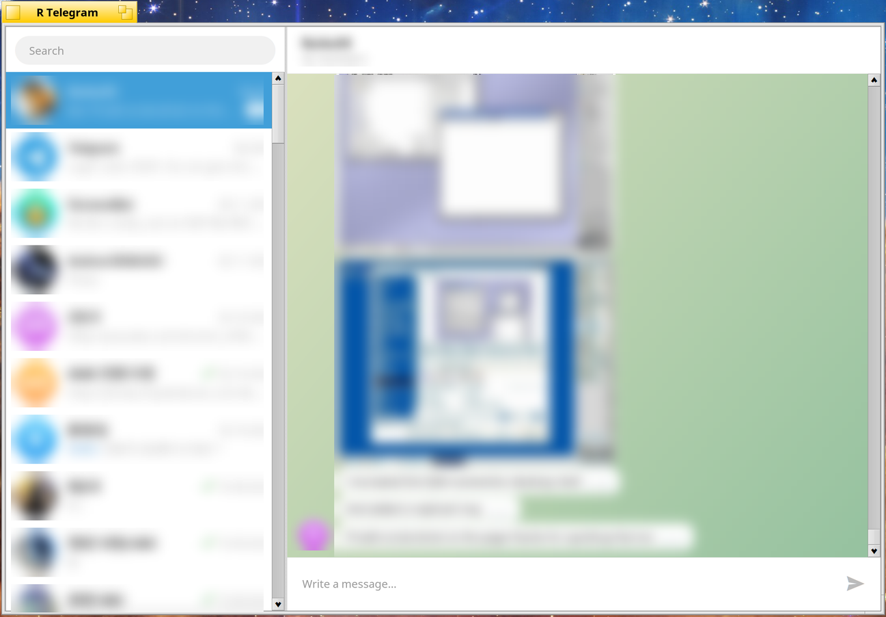

# R Telegram

[English](README.md) | [한국어](README.ko.md)

A native Telegram client for Haiku and RenkuOS. It uses
[TDLib](https://github.com/tdlib/td), Telegram's own client library, for the
protocol, and the Haiku API for every window: no Qt.

*Names, messages and profile pictures are blurred.*

## Install

R Telegram is published for **arm64** and **32-bit x86 (x86_gcc2)**. There is
no x86_64 build yet.

1. Find your architecture. The name at the end of the installed `haiku`
   package is the answer:

       ls /system/packages/haiku-*.hpkg
       # .../haiku-r1~beta5_hrev58000-1-arm64.hpkg  ->  arm64

2. Add the repository for it and install:

   | Architecture | Commands |
   | --- | --- |
   | arm64 | `pkgman add-repo https://pkgman.rainygirl.com/arm64` `pkgman refresh` `pkgman install rtelegram` |
   | 32-bit x86 (x86_gcc2) | `pkgman add-repo https://pkgman.rainygirl.com/x86_gcc2` `pkgman refresh` `pkgman install rtelegram_x86` |

   If `pkgman add-repo` fails with `Operation not supported`, that image's
   network kit has no TLS; use `http://` instead of `https://`.

3. Start **R Telegram** from Deskbar -> Applications.

4. The first start asks for your API credentials (next section), then for
   your phone number, the login code and, if you set one, your two-step
   verification password.

To update later, run `pkgman update rtelegram` (`rtelegram_x86` on 32-bit
x86). To remove it, run `pkgman uninstall rtelegram`. Your session and
credentials stay in `~/config/settings/RTelegram`; delete that folder too to
sign out of this machine completely.

## Your API credentials

Every Telegram client needs an `api_id` and an `api_hash`. R Telegram does not
ship any: you use your own, which Telegram gives to anyone with an account.

1. Open <https://my.telegram.org> and sign in with your phone number. The code
   arrives in your Telegram app.
2. Choose **API development tools**.
3. Fill in the form. Any title and short name will do (for example
   "R Telegram" and "rtelegram"); the platform can be "Desktop". Create the
   application.
4. Copy **App api_id** (a number) and **App api_hash** (32 characters).

Start R Telegram and paste them into the window it shows. They are saved in
`~/config/settings/RTelegram/api`, readable only by you, and used for nothing
but signing in to Telegram. Delete that file to enter different ones.

Keep the `api_hash` to yourself: it identifies your application to Telegram.

## Signing in

After the credentials, R Telegram asks for your phone number, then the code
Telegram sends to your other devices (or by SMS), then your two-step
verification password if you set one. Accounts are created in the official
apps; R Telegram only signs in to existing ones.

The session and Telegram's local database live in
`~/config/settings/RTelegram/tdlib`.

## What it does

- Chat list in Telegram's order (pinned first), with the last message, its
  time and the unread count.
- Messages as bubbles, your own on the right; sender names in groups; photos
  inline; dates between days. Scrolling to the top loads older messages.
- Sending text messages; opened chats are marked as read.
- A notification for a new message that is not in the chat you are reading.

Not yet: voice and video calls, sending files and photos, stickers and GIFs
drawn (they show as "[Sticker]" and the like), secret chats.

## Building

TDLib is built as static libraries with the Haiku cross toolchain, then the
app is compiled against it:

    docker cp tools/build-tdlib.sh haiku-builder:/tmp/
    docker cp tools/patch-tdlib.py haiku-builder:/tmp/
    docker exec haiku-builder sh /tmp/build-tdlib.sh arm64
    tools/cross-build.sh arm64

`tools/patch-tdlib.py` is the whole of the Haiku port of TDLib: Haiku is a
POSIX system with `poll()` and pthreads, but defines `__HAIKU__` rather than
`__unix__`, which TDLib and its bundled SQLite test for.

## License

MIT. TDLib is under the Boost Software License 1.0.
